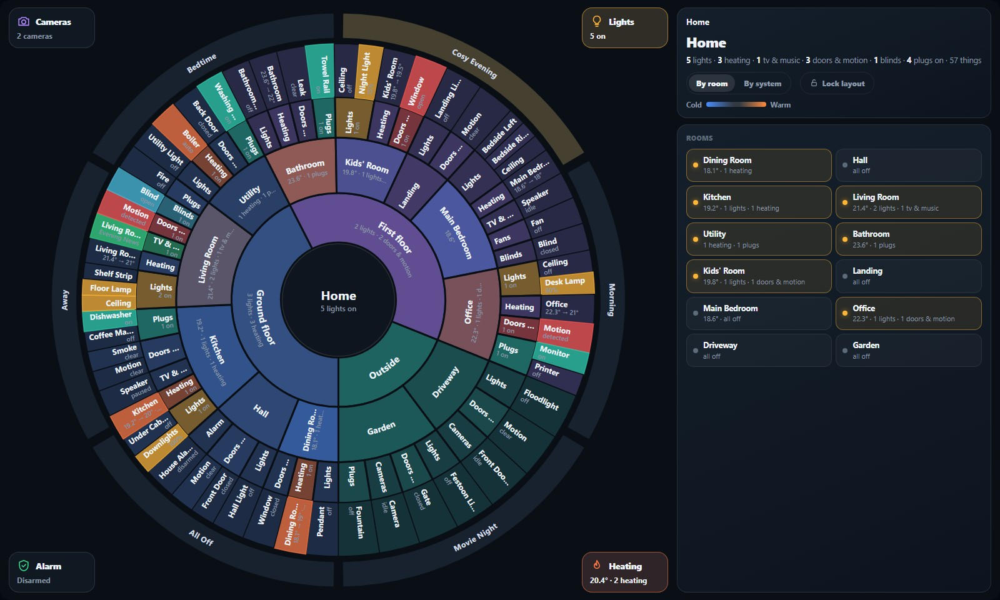
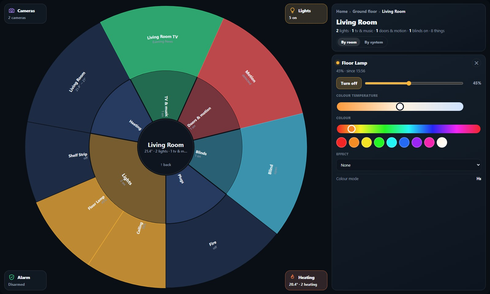
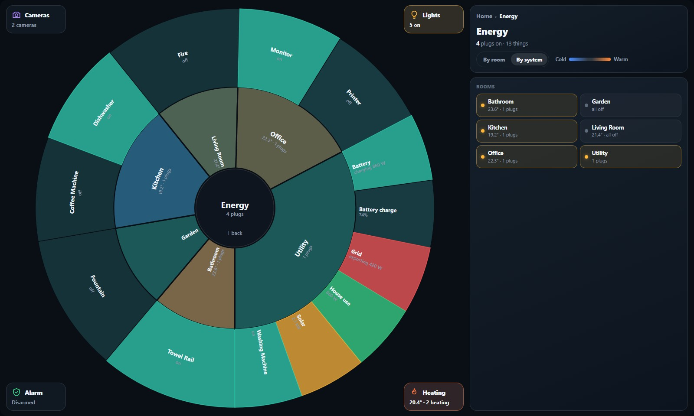
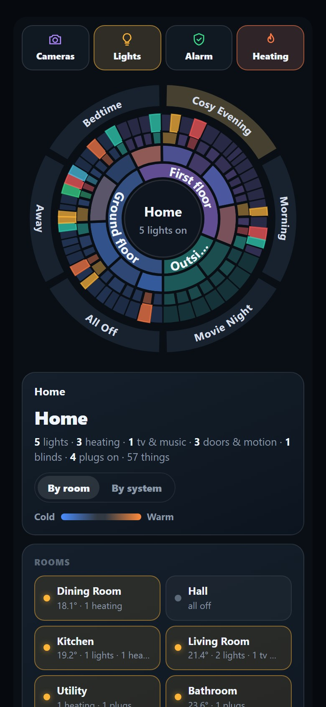
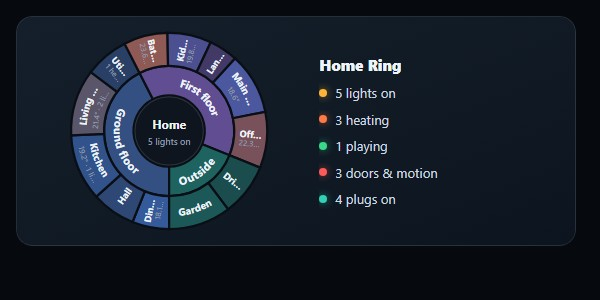
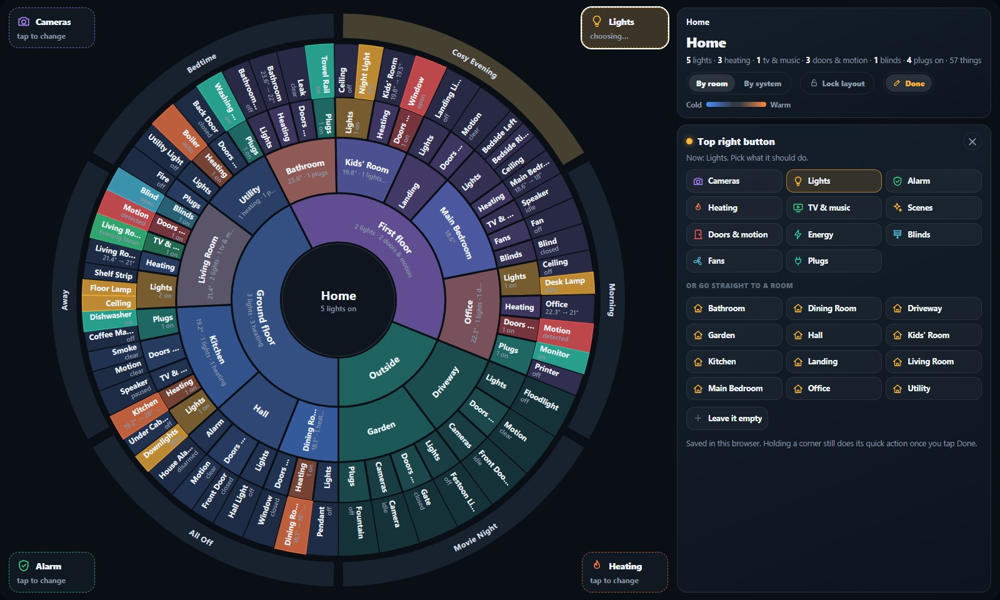

# Home Ring

A Home Assistant card that shows your home as a ring you can drill into.

The centre is where you are. The rings around it are your floors, then rooms, then kinds of thing (lights, heating, TV & music, doors & motion…), then the things themselves. Tap a room to go in and tap the centre to come back out. Colours show what's on, right now.



Home Ring reads Home Assistant's own floors, rooms (areas) and devices, so there is nothing to list by hand. **Every device with a room is on the ring.** Give a new device a room and it appears within a second or two, whatever kind of device it is.

## What it does

- **Every device with a room appears**, sorted into Lights, Heating, TV & music, Doors & motion, Safety, Alarm, Locks, Cameras, Fans, Blinds, Valves, Vacuums, Sirens, Plugs, Sensors or Other.
  - A device's readings, such as a plug's power or a sensor's humidity and battery, go on its card rather than cluttering the ring.
  - A device the card has no buttons for still gets its live state and a **More controls** button, which opens Home Assistant's own controls for it.
- **Safety alerts.** When a water leak, smoke, gas or carbon monoxide sensor goes off, its room flashes and its card opens.

- **Tap** a floor, room or kind to go in. Tap the centre to go back out.
- **Tap a thing** to open its card: brightness, colour, colour temperature and effects for lights; target, modes and a 24-hour graph for thermostats; play, volume and source for media; open, stop and close for blinds; stills for cameras.
- **Hold** a light, switch, fan or speaker to switch it. **Hold a room** to switch all its lights: off if any are on, otherwise on.
- **Slide** up or down on a dimmable light to set its brightness, without opening anything.
- **Room colours follow the temperature.** A room with a thermostat leans blue when it's cold and orange when it's warm.
- **Motion makes the room pulse**, so you can see someone walk through the house.
- **Scenes** sit in a band around the outside. Tap one to run it.
- **Layout lock.** Tap **Lock layout** and every room stays exactly where it is. New devices squeeze into their room, and a new room starts slim at the end of its floor, so the rooms you know move a degree or two at most. **Re-tidy** lays everything out afresh. The lock is kept in Home Assistant, so every screen shows the same ring.
- **By room or By system.** Switch the ring to Lights, Heating, Energy, TV & music, Security and Blinds, each split by room. Energy can include your solar, battery and grid readings.
- **Four corner buttons**, Cameras, Lights, Alarm and Heating to start with. Tap one for its card and hold it for its quick action. Tap **Customise** to change what each corner does. Choose from:
  - **Cameras** opens a grid of stills, and opens by itself when a doorbell rings.
  - **Lights:** hold to switch the whole house.
  - **Alarm** arms from the ring. Disarming always goes through Home Assistant's own keypad.
  - **Heating** gives every thermostat − and +, and your boiler's modes. Hold it for a boost.
  - **TV & music** shows what's playing. Hold it to pause everything.
  - **Scenes** lists every scene, to run with one tap.
  - **Doors & motion** shows what's open now and any movement in the last hour.
  - **Energy** shows your power readings and plugs.
  - **Blinds:** hold to close them all, or open them all.
  - **Fans:** hold to turn them all off.
  - **Plugs** lists every plug to switch.
  - **A room shortcut:** tap goes straight to that room, and hold switches its lights.
  - **Empty** hides that corner.
- **Voice (optional):** "show me the kitchen" moves the ring to the kitchen.
- **Mini card:** a small summary that opens the full ring when tapped.
- Works on wall tablets, desktops and phones. On a phone the panel moves under the ring.

| A room, with a light's card open | By system: Energy | On a phone |
|---|---|---|
|  |  |  |

## Install

### HACS (recommended)

[](https://my.home-assistant.io/redirect/hacs_repository/?owner=anchorapp100&repository=home-ring-card&category=plugin)

The button opens your own Home Assistant on this repository; download Home Ring, then reload your browser. In Home Assistant 2026.11 and later, HACS is built in as the **Marketplace** (Settings → Marketplace) and the button works there too. Or do it by hand:

1. In HACS, open the **⋮** menu → **Custom repositories**.
2. Add `https://github.com/anchorapp100/home-ring-card` with the type **Dashboard**.
3. Find **Home Ring** in HACS and download it.
4. Reload your browser.

### By hand

1. Copy `dist/home-ring-card.js` to `<config>/www/home-ring-card/home-ring-card.js`.
2. Go to **Settings → Dashboards → ⋮ → Resources → Add resource**.
3. Enter the URL `/local/home-ring-card/home-ring-card.js` and choose **JavaScript module**.
4. Reload your browser.

## What shows up, and where

| In Home Assistant | On the ring |
|---|---|
| Lights; switches with "light", "lamp" or "bulb" in the name | Lights |
| Other switches | Plugs |
| Thermostats, water heaters, humidifiers | Heating |
| TVs, speakers, media players | TV & music |
| Door, window, motion, occupancy and presence sensors | Doors & motion |
| Leak (moisture), smoke, gas, carbon monoxide and safety sensors | Safety, with an alert when one goes off |
| Alarm panels | Alarm |
| Locks: unlocking takes two taps | Locks |
| Cameras | Cameras |
| Fans | Fans |
| Blinds, curtains, garage doors | Blinds |
| Water and gas valves | Valves |
| Robot vacuums, lawn mowers | Vacuums |
| Sirens: sounding one takes two taps, and a hold never sounds it | Sirens |
| A device that only has readings (a temperature sensor, a solar charger, a scale) | Sensors, shown by its most useful reading |
| Anything else with a room (hubs, remotes, toggles, buttons) | Other |

A sensor is sorted by what Home Assistant says it detects. If a leak sensor arrives without that, open its settings in Home Assistant and set **Show as → Moisture**.

## Before you start: rooms and floors

The ring is only as tidy as your rooms. Every thing you want to see needs a room, either its own or its device's. Rooms should have a floor.

- Set rooms and floors in **Settings → Areas, labels & zones**.
- Set a device's room on the device's page (the pencil icon).

Hidden entities and entities marked as configuration or diagnostic are left out automatically.

**Let an AI do the setup.** [AI_SETUP.md](AI_SETUP.md) has a Home Assistant template that lists your rooms and devices, and a prompt to paste into Claude, ChatGPT or Gemini with that list. It writes your card, suggests rooms for things that don't have one, and asks about cameras, doorbells and heating.

## Add the card

The smallest card is one line:

```yaml
type: custom:home-ring-card
```

### Full screen on a wall tablet

Add a view in panel mode with just the ring:

```yaml
views:
  - title: Home Ring
    path: ring
    panel: true
    cards:
      - type: custom:home-ring-card
        height: calc(100vh - 56px)    # 100vh - 16px if your header is hidden
        back_path: /lovelace/0        # optional "← Back" button
```

### A mini card that opens the full ring

```yaml
type: custom:home-ring-card
mini: true
navigation_path: /dashboard-home/ring
```



### Everything

```yaml
type: custom:home-ring-card
height: calc(100vh - 56px)
mode: rooms                         # or systems
exclude:                            # things to leave out
  - "*.wall_tablet_*"               # entity id pattern
  - "*_segment_*"
  - screensaver                     # a word in the name
exclude_areas: [Garage]
strip_prefixes: [Acme Smart Bulb]   # "Acme Smart Bulb Hall" shows as "Hall"
lights_exclude: [alarm, night light]   # never switched by "all lights" or room holds
scenes: true                        # or false, or a list of scene ids in your order
cameras:
  - name: Front door
    entities: [camera.front_door, camera.front_door_snapshot]   # second one is a fallback
    doorbell: binary_sensor.front_door_ding                     # opens the cameras when it rings
    motion: [binary_sensor.driveway_motion]                     # lights the Cameras button red
  - name: Garden
    entity: camera.garden
camera_refresh: 2                   # seconds between stills
cameras_path: /dashboard-home/cameras   # "Live view" goes here instead of the pop-up
alarm: alarm_control_panel.house
alarm_path: /dashboard-home/alarm       # "Disarm…" goes here instead of the keypad pop-up
heating:
  entity: water_heater.boiler
  hold_mode: boost_60               # what a long press on Heating does
energy:                             # shown under By system → Energy
  - {entity: sensor.solar_power, name: Solar, kind: solar}
  - {entity: sensor.battery_power, name: Battery, kind: battery}   # + = charging
  - {entity: sensor.battery_soc, name: Battery charge, kind: battery_level}
  - {entity: sensor.grid_power, name: Grid, kind: grid}            # + = importing
  - {entity: sensor.house_power, name: House use, kind: load}
  # add invert: true to any reading whose sign runs the other way
voice_entity: input_text.home_ring_focus
temperature_tint: true
comfort_temperature: 20.5           # rooms at this temperature keep their own colour
temperature_span: 4                 # fully blue or orange this many degrees away
motion_pulse: true
devices: true                       # every device with a room
safety_alerts: true
hot_buttons: true
corners: [cams, lights, media, room:kitchen]   # top left, top right, bottom left, bottom right
layout_lock: true
```

| Option | Default | What it does |
|---|---|---|
| `height` | `min(78vh, 760px)` (mini: `220px`) | Card height, any CSS length |
| `mini` | `false` | Summary card; tap to open `navigation_path` |
| `navigation_path` | none | Where the mini card goes |
| `back_path`, `back_label` | none, `Back` | Adds a back button to the panel |
| `mode` | `rooms` | Starting view. Each browser remembers the last one used |
| `exclude` | none | Entity id patterns (`*` wildcard) or words in the name |
| `exclude_areas` | none | Room names or ids to leave out |
| `strip_prefixes` | none | Words removed from the start of names |
| `lights_exclude` | none | Lights left out of house and room switching |
| `scenes` | `true` | Scene band: `true`, `false`, or a list |
| `hot_buttons` | `true` | The four corner buttons |
| `corners` | `[cams, lights, alarm, heat]` | Starting choice for the corners: top left, top right, bottom left, bottom right. Kinds: `cams`, `lights`, `alarm`, `heat`, `media`, `scenes`, `doors`, `energy`, `blinds`, `fans`, `plugs`, `room:<area id>`, `none`. A choice made with Customise overrides it |
| `customise`, `corners_key` | `true`, `home_ring_corners` | Show the Customise button; name the choice is saved under |
| `cameras` | every camera with a room | Camera stills, doorbells and motion |
| `camera_refresh` | `2` | Seconds between stills |
| `cameras_path`, `alarm_path` | none | Open a view instead of Home Assistant's pop-up |
| `alarm` | first alarm panel | Alarm entity |
| `heating.entity`, `heating.hold_mode` | first water heater, none | Boiler modes and the hold action |
| `energy` | none | Power readings for By system → Energy |
| `voice_entity` | none | See "Voice" below |
| `temperature_tint`, `comfort_temperature`, `temperature_span` | `true`, `20.5`, `4` | Room colour by temperature |
| `motion_pulse` | `true` | Rooms pulse on motion |
| `devices` | `true` | Put every device with a room on the ring; `false` shows only lights, heating, media, sensors, cameras, fans, blinds, plugs and the alarm |
| `safety_alerts` | `true` | Flash the room and open the card when a leak, smoke, gas or CO sensor goes off |
| `layout_lock` | `true` | Show the Lock layout button and follow a saved lock (`false` hides it) |
| `layout_key` | `home_ring_layout` | Name the lock is saved under; give two rings different keys to lock them separately |

## Corner buttons

Tap **Customise** in the panel. The four corners get a dashed outline. Tap one, pick what it should do, and tap **Done**. While Customise is on, holding a corner does nothing, so nothing gets switched while you set it up.



The choice is saved in Home Assistant, like the layout lock, so every screen shows the same corners. Choosing for everyone needs an admin; anyone else changes only their own browser. To fix the corners in YAML instead, set `corners:` and `customise: false`.

## Layout lock

Without a lock, rooms are placed by a fixed rule: floors in level order, rooms in name order, and each room sized by how many things it has. Switching things on and off never moves anything. Adding a device nudges its neighbours by a degree or so, but a new room slots in by name and can push the rooms after it round by 15–25°.

Tap **Lock layout** in the panel to pin the ring as it is:

- Every floor, room, kind and thing keeps its place and size.
- New devices fit inside their room's slice.
- A new room joins the end of its floor, slim at first. The ring turns slightly so the rooms you know stay put, typically moving 2–5° at most.
- **Re-tidy** lays the ring out afresh, with new rooms at full size, and locks it again. Tap **Locked** to unlock.

The lock is saved in Home Assistant's shared frontend data, so the tablet, phones and browsers all show the same ring, and they all update when it changes. Locking for everyone needs an admin user. Anyone else locks only their own browser, and so does a Home Assistant too old for shared frontend data.

## Voice (optional)

Say "show me the kitchen", "show me the first floor" or "show me the whole house", and the ring on screen moves there. This uses Home Assistant's own list of rooms and floors, so there's nothing to update when you add a room.

1. Turn on packages if you haven't. In `configuration.yaml`:
   ```yaml
   homeassistant:
     packages: !include_dir_named packages
   ```
2. Copy [`extras/voice/home_ring_voice.yaml`](extras/voice/home_ring_voice.yaml) into `<config>/packages/`.
3. Copy [`extras/voice/custom_sentences/en/home_ring.yaml`](extras/voice/custom_sentences/en/home_ring.yaml) into `<config>/custom_sentences/en/`.
4. Restart Home Assistant.
5. Add `voice_entity: input_text.home_ring_focus` to the card.

The ring moves when it's on screen. To also switch a tablet to the ring's view, add a navigation action to the intents, for example with Browser Mod.

## Try it without Home Assistant

**[Open the live demo](https://anchorapp100.github.io/home-ring-card/demo/)**. It runs the card on a made-up house, with buttons to ring the doorbell, walk into the kitchen and send a voice request.

The demo is one self-contained file, [`demo/index.html`](demo/index.html), so you can also download it and open it from your computer. If you change the card or the demo, rebuild it with `node demo/build.mjs`; it is generated from `demo/template.html`.

## Good to know

- **Looks:** the card has its own dark look, made for wall tablets. It doesn't follow light themes.
- **Browsers:** it needs a current browser: Chrome or Edge 111+, Safari 16.4+, Firefox 113+. The Home Assistant apps are fine.
- **Privacy:** the card talks only to your own Home Assistant, through the connection the dashboard already has. It sends nothing anywhere else, has no tracking, and loads nothing from the internet.
- **Safety:** disarming the alarm always needs the code, through Home Assistant's keypad. Arming from the ring only works when your alarm doesn't ask for a code to arm.
- **Busy rooms:** a room with dozens of things gets thin slices. Hide what you never use, either in Home Assistant or with `exclude`.

## Licence

MIT. See [LICENSE](LICENSE).
